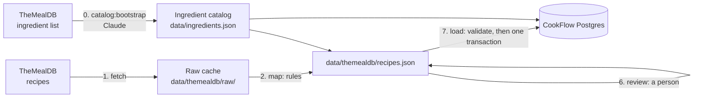

# CookFlow Ingest

[](https://github.com/moneychien19/CookFlow-Ingest/actions/workflows/ci.yml)

**Turns recipes from external sources into data that [CookFlow](https://github.com/moneychien19/CookFlow)'s meal planner can use.**


## Why

CookFlow plans several meals at once around what's already in a cook's pantry. To do that, its planner needs every recipe in one shape: each ingredient line mapped to a canonical ingredient ("onion", "chicken breast") with a quantity in that ingredient's single unit ("0.5 whole", "400 g").

Recipe sources don't look like that. TheMealDB writes "Red Onion" / "1 chopped" and "Chicken Breasts" / "2", and its instructions come as paragraphs, `step 1` headers, or half-numbered lists. This repo turns all of that into canonical quantities and numbered steps. Rules handle the easy cases, Claude proposes the rest offline, code checks every answer, and a person reviews everything before it's loaded into CookFlow's database.

## Tech stack

| | |
|---|---|
| Language | TypeScript (strict, `noUncheckedIndexedAccess`) on Node 22, run with `tsx` |
| Validation | [zod](https://zod.dev) 4 at every boundary: API responses, data files, CLI arguments, Claude's replies |
| Database | Postgres on [Neon](https://neon.tech), through [Drizzle ORM](https://orm.drizzle.team) and Neon's WebSocket `Pool` driver (needed for interactive transactions) |
| LLM | Claude (`claude-opus-5-5`) through the [Anthropic TypeScript SDK](https://github.com/anthropics/anthropic-sdk-typescript), with structured outputs and prompt caching. Used only from the CLI, offline |
| Tests | [Vitest](https://vitest.dev); database tests run against a throwaway Neon branch |
| Lint / CI | ESLint with typescript-eslint; GitHub Actions runs typecheck, lint, and tests on every push |

## Data pipeline



| # | Stage | Command | Calls | Writes |
|---|---|---|---|---|
| 0 | Catalog bootstrap (once) | `npm run catalog:bootstrap` | Claude | `data/ingredients.json`, `data/catalog/bootstrap-proposals.json` |
| 1 | Fetch | `npm run ingest:fetch -- themealdb --limit 200` | TheMealDB | `data/themealdb/raw/<id>.json` |
| 2 | Map | `npm run ingest:map -- themealdb` | nothing | `data/themealdb/recipes.json`, `reports/unmapped.json` |
| 3 | Normalize | `npm run ingest:normalize -- themealdb` | Claude | `recipes.json` (and new draft ingredients in the catalog) |
| 4 | Steps | `npm run ingest:steps -- themealdb` | Claude | `recipes.json` |
| 5 | Report | `npm run ingest:report -- themealdb` | nothing | `reports/review-queue.json` |
| 6 | Review | edit the JSON files by hand | nothing | `ingredients.json`, `recipes.json` |
| 7 | Load | `npm run ingest:load -- themealdb [--dry-run]` | the database | CookFlow's `ingredients`, `recipes`, `recipe_ingredients` |

Everything after fetch reads files committed to the repo, so a run can be reproduced without calling TheMealDB again. Each stage can be rerun safely: none of them overwrites an `approved` recipe or a reviewer's work.

### 0. Catalog bootstrap
The catalog is the list of canonical ingredients every line must map to: `{ name, unit, isStaple, aliases, reviewed, note }`. It's drafted from TheMealDB's ingredient list (about 990 names). Claude proposes a canonical name, unit, and staple flag for each name; code groups the names into entries, with the source spellings as aliases ("red onion" → `onion`). Every entry starts `reviewed: false`. Proposals are cached, so a rerun only asks about new names.

Units are the 7 that CookFlow's database allows: `whole`, `bunch`, `clove`, `count`, `pack` for counted things, and `g` / `ml`.

### 1. Fetch
Downloads recipes letter by letter (`search.php?f=a`, `b`, ...), skips the Dessert category, and caches each raw response as returned. Responses are validated with zod before they're written.

### 2. Map (rules)
For each ingredient line:
1. Match the source name against catalog names and aliases.
2. Convert the measure into the ingredient's unit: fractions and unicode fractions, `g`/`kg`/`oz`/`lb` → g, `tsp`/`tbsp`/`cup`/`l` → ml, counts and count words ("2 cloves", "1 bunch", "juice of 1"). Preparation words that don't change the amount ("1 chopped", "2 large") are allowed.
3. A staple whose measure doesn't convert ("to taste", "pinch") gets a nominal quantity of 1, because the planner ignores staples.
4. Anything else stays unmapped with the reason, for example "a count for an ingredient measured in g". Rules never guess.

A recipe where two lines map to the same ingredient is dropped, since CookFlow stores one row per ingredient per recipe.

### 3. Normalize (Claude)
Sends each pending recipe's unmapped lines to Claude with the whole recipe for context and the catalog in a cached system prompt. Claude answers per line: an existing ingredient with a quantity, a new ingredient (which joins the catalog as an unreviewed draft), or "can't map". Each answer is stored with `method: "claude"` and a one-sentence note for the reviewer ("900 g at about 200 g per potato"). Code rejects answers that switch an ingredient, invent one that isn't in the catalog, or give an unusable quantity; those lines are asked again next run.

### 4. Steps (Claude)
Splits each recipe's instructions into numbered steps (`1. …\n2. …`). Claude only decides where steps start; code checks the answer against the raw cache word by word. Every word must still be there, in order, with the same spelling and punctuation. Only the source's own step labels may go (`step 1`, `2.`, bare step numbers). An answer that changes anything else is rejected and the recipe keeps its original text, so food-safety steps can't be lost.

### 5. Report
Prints progress (pending / approved / dropped, drop reasons, how lines were mapped, the vegetarian count against the targets) and the **catalog review queue**: unreviewed catalog entries that pending or approved recipes use, most-used first. Only those entries need a review; the rest of the catalog can stay as drafts.

### 6. Review (a person)
- In `data/ingredients.json`: check each queued entry's unit, staple flag, and aliases, then set `reviewed: true`.
- In `data/themealdb/recipes.json`: check Claude's lines, fix any line (and set its `method` to `"manual"`), then set the recipe's `status` to `approved` or `dropped` with a `dropReason`.
- Rerun `map` after changing a catalog unit, so rule-mapped lines are converted again.

### 7. Load
Before connecting to the database, every approved recipe is validated: title and ingredient lines identical to the raw cache, instructions keeping every word, every ingredient reviewed and used once, every quantity fitting `numeric(8,2)`. Any problem stops the load, and all problems are listed at once.

The load then runs in one transaction: it inserts the reviewed ingredients that approved recipes use, upserts recipes on `(source, source_id)`, and replaces their ingredient lines. An existing ingredient is never modified; if its unit differs from the catalog, the load fails and rolls back. `--dry-run` prints the plan and writes nothing. Running the load twice leaves the same rows.

### Loads

Each row is one load into CookFlow's database and what it added.

| Date | Source | Added |
|---|---|---|
| 2026-10-14 | TheMealDB | 158 recipes (17 vegetarian), 328 ingredients, 1,577 recipe ingredient lines |

## Key decisions and trade-offs

| Decision | Why | Cost |
|---|---|---|
| CookFlow's database schema is the source of truth | One place defines the data; this repo only writes data in that format | Table definitions here are copied by hand; schema drift isn't detected yet |
| Source text kept word for word: title, ingredient names and measures exactly; instructions re-split into numbered steps, checked word by word | CookFlow shows recipes as the source wrote them, including food-safety steps, but in a consistent step format | Typos and odd wording in the source stay |
| Ingredients come only from a reviewed catalog, never straight from source names | "Onion", "onions", and "Red Onion" must be one ingredient, or the planner can't match them to the pantry | Every ingredient a recipe uses needs a review decision (name, unit, staple) |
| This repo owns CookFlow's `ingredients` table | One writer, so units can't be changed under existing quantities | CookFlow no longer seeds its own ingredients |
| Existing ingredients in the database are never modified; a unit conflict fails the load | Quantities computed for one unit are wrong in another (1 pack of chicken loaded as 1 g) | Changing a unit after loading needs a manual fix in the database |
| Rules first, Claude only for what's left, code checks Claude's answers, a person approves | Rules are deterministic and testable; Claude handles messy text; checks and review catch mistakes | Review is the slow, manual step |
| Drop recipes that don't map cleanly | 50 good recipes are better than 100 noisy ones | Fewer recipes (21% dropped in the first run) |
| Raw responses and reviewed files committed | Reproducible runs, no repeated API calls, review history in git | Larger repo |

## Sources

| Source | Status |
|---|---|
| [TheMealDB](https://www.themealdb.com/api.php) | Loaded |

Each source is an adapter (`src/sources/<name>/`) with a zod schema for its raw records and two functions: `fetch()` downloads and caches raw records, and `toSourceRecipe()` converts one into a common shape. Mapping, normalization, steps, review, validation, and loading are shared by all sources. A new source is registered in `src/sources/registry.ts`.

## Running locally

```bash
cp .env.example .env.local   # DATABASE_URL (a Neon dev branch, not production), ANTHROPIC_API_KEY
                             # TEST_DATABASE_URL (optional): runs the *.db.test.ts tests against that database
npm install

npm run catalog:bootstrap                 # once; calls Claude
npm run ingest:fetch -- themealdb --limit 200
npm run ingest:map -- themealdb
npm run ingest:normalize -- themealdb     # calls Claude; --limit, --max-requests cap the run
npm run ingest:steps -- themealdb         # calls Claude; --only <id,id>, --limit, --max-requests
npm run ingest:report -- themealdb
# review data/ingredients.json (the queue) and data/themealdb/recipes.json by hand
npm run ingest:load -- themealdb --dry-run
npm run ingest:load -- themealdb

npm run typecheck && npm run lint && npm test
```

Stages that call Claude save after every recipe, so an interrupted run loses nothing; a rerun picks up where it stopped. The database tables are created by CookFlow's migrations (`npm run db:migrate` in the CookFlow repo). This repo doesn't create or change them.

## Project layout

```
src/
  cli/         one entry point per npm script; argument parsing and usage
  sources/     source adapters (themealdb/) and the adapter registry
  schema/      zod schemas for every file format
  catalog/     catalog matching, bootstrap prompt, grouping proposals into entries
  map/         measure parsing and rule-based mapping
  normalize/   Claude prompt and answer checks for unmapped lines
  steps/       Claude prompt for numbered steps and the word-by-word check
  claude/      structured-output client and token cost tally
  validate/    checks run on approved recipes before loading
  load/        load plan, transaction, dry-run output
  report/      progress and review queue
  db/          Drizzle table definitions (copied from CookFlow) and the client
data/
  ingredients.json                  the catalog
  catalog/bootstrap-proposals.json  Claude's cached catalog proposals
  themealdb/raw/                    raw API responses
  themealdb/recipes.json            mapped and reviewed recipes
  themealdb/reports/                generated reports (git-ignored)
```
