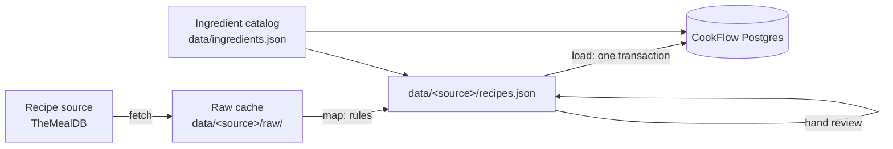

# CookFlow Ingest

**Turns recipes from external sources into data that [CookFlow](https://github.com/moneychien19/CookFlow)'s meal planner can use.**

> **Status:** the pipeline is built and tested; the first TheMealDB recipes haven't been reviewed or loaded yet. [SPEC.md](SPEC.md) describes the behavior; [tasks/plan.md](tasks/plan.md) tracks the work.

---

## Why

CookFlow plans several meals at once around what's already in a cook's pantry. To do that, its planner needs every recipe in one shape: each ingredient line mapped to a canonical ingredient ("onion", "chicken breast") with a quantity in that ingredient's single unit ("0.5 whole", "400 g").

Recipe sources don't look like that. TheMealDB writes "Red Onion" / "1 chopped" and "Chicken Breasts" / "2". This repo turns lines like those into canonical quantities. Rules handle the easy cases, Claude proposes mappings for the rest, and a person reviews everything before it's loaded into CookFlow's database.

## How it works



1. **Fetch** raw recipes from the source and cache them in the repo.
2. **Map** each ingredient line with rules: match the name against the ingredient catalog and its aliases, then parse the measure (fractions, counts, weights, volumes) into the ingredient's unit.
3. **Normalize** the lines the rules couldn't map. Claude proposes an existing ingredient or a new one, with a quantity and a short note explaining its reasoning.
4. **Review** by hand: fix lines, accept or reject new ingredients, and mark each recipe `approved` or `dropped`.
5. **Load** approved recipes into the database in one transaction. The load is idempotent, so running it twice leaves the same rows.

Every stage after fetch runs offline from files committed to the repo, so a run can be reproduced without calling the source again.

## Key decisions and trade-offs

| Decision | Why | Cost |
|---|---|---|
| CookFlow's database schema is the source of truth | One place defines the data; this repo only writes data in that format | Table definitions here are copied by hand; schema drift isn't detected yet |
| Source text kept verbatim (title, instructions, ingredient name and measure) | CookFlow shows recipes exactly as the source wrote them, including food-safety steps | Display can't tidy up messy source text |
| Ingredients come only from a reviewed catalog, never straight from source names | "Onion", "onions", and "Red Onion" must be one ingredient, or the planner can't match them to the pantry | Every new ingredient needs a review decision (name, unit, staple) |
| Existing ingredients in the database are never modified; a unit conflict fails the load | Quantities computed for one unit are wrong in another (1 pack of chicken loaded as 1 g) | CookFlow and this repo have to agree on units |
| Rules first, Claude only for what's left, a person approves everything | Rules are deterministic and testable; Claude handles messy text; review catches mistakes | Review is the slow, manual step |
| Drop recipes that don't map cleanly | 50 good recipes are better than 100 noisy ones | Fewer recipes |
| Raw responses and reviewed files committed | Reproducible runs, no repeated API calls, review history in git | Larger repo |

## Sources

| Source | Status |
|---|---|
| [TheMealDB](https://www.themealdb.com/api.php) | First source |

Each source is an adapter with two functions: `fetch()` downloads and caches raw records, and `toSourceRecipe()` converts a raw record into a common shape. Mapping, normalization, review, validation, and loading are shared by all sources.

## Running locally

```bash
cp .env.example .env.local   # DATABASE_URL (a Neon dev branch, not production), ANTHROPIC_API_KEY
                             # TEST_DATABASE_URL (optional): runs the *.db.test.ts tests against that database
npm install

npm run catalog:bootstrap      # once: drafts data/ingredients.json from TheMealDB's ingredient list (calls Claude)
npm run ingest:fetch -- themealdb --limit 200
npm run ingest:map -- themealdb
npm run ingest:normalize -- themealdb   # calls Claude for the lines the rules couldn't map
npm run ingest:report -- themealdb      # progress, drop reasons, and the catalog review queue
# review data/ingredients.json (the queue) and data/themealdb/recipes.json by hand
npm run ingest:load -- themealdb --dry-run
npm run ingest:load -- themealdb

npm run typecheck && npm run lint && npm test
```

The database tables are created by CookFlow's migrations (`npm run db:migrate` in the CookFlow repo). This repo doesn't create or change them.
